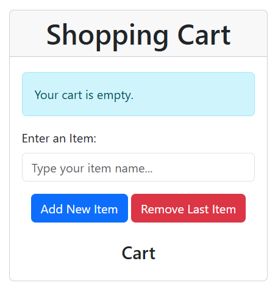
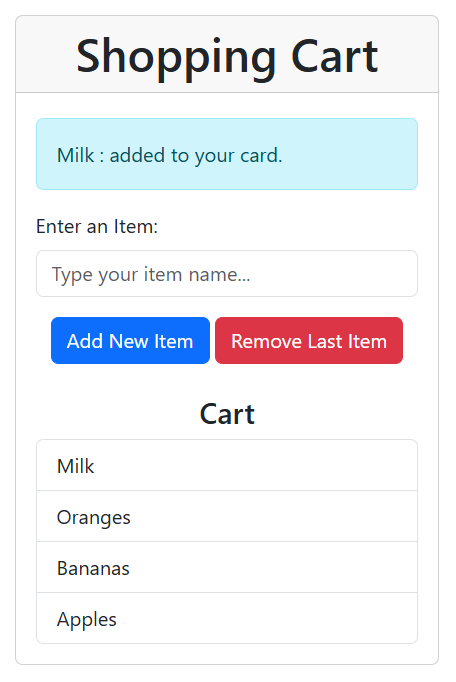
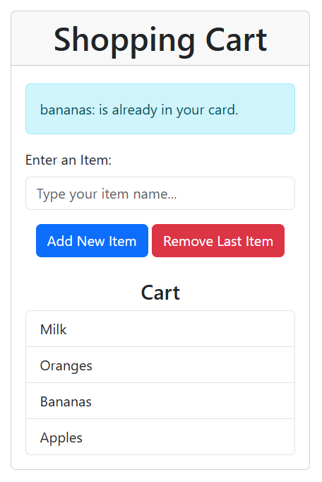

# Lab 4.2: Array Manipulation

A shopping cart page that stores item names in an array. You can add an item, skip a duplicate, and remove the last item that was added. The list on the page is drawn from that array.

Open `index.html` in a browser. The page loads Bootstrap from a CDN, so it needs a network connection for the styles.

## Screenshots

**Empty cart.** The page starts with an empty list and a short status message.

**Items added.** Each new item is pushed onto the array and shown at the top of the list. The newest item here is Milk.

**Duplicate blocked.** Adding `bananas` does not create a second row, because `Bananas` is already in the list. The check ignores letter case.

## What you can do

1. Type an item name and press **Add New Item**.
2. Press **Remove Last Item** to take off the most recently added item. On the page, that is the first row.
3. Read the blue alert for the result of the last add, or for an empty cart.

Blank input is ignored. The cart is kept in memory for the current page only. A refresh starts over with an empty list.

## Array methods

| Function | What it does |
| --- | --- |
| `addItem` | Adds a name with `push()` |
| `removeLastItem` | Removes the last name with `pop()` |
| `displayList` | Prints the numbered list to the console |
| `addItemNew` | Adds a name only if `some()` does not already find the same name, ignoring case |
| `filterItems` | Returns names that `filter()` matches against a search term, ignoring case |

`filterItems` is available in `script.js`. The page itself adds, removes, and redraws the list.

## Reflection Questions

**1. How did array methods like push() and filter() help you manipulate data in this activity?**
Array methods made data manipulation much simpler and cleaner. The `push()` method allowed me to easily add new items to the end of the `shoppingList` array without needing to manually manage the array's index length. The `filter()` method (and `some()`) was incredibly helpful for searching because it allowed me to concisely check conditions (like finding matches) without having to write long, traditional `for` loops.

**2. What challenges did you face when trying to filter and search for items in the array?**
The main challenge was dealing with case sensitivity. For example, if a user tried to add "bananas" but the list already contained "Bananas", a standard comparison would treat them as two different items. To solve this, I had to ensure both the user's input and the existing items in the array were converted to lowercase using `.toLowerCase()` before comparing them with methods like `.includes()` or `.some()`.

**3. How would you modify this code to make it more efficient or user-friendly?**
To make it more user-friendly, I could add a feature that allows the user to remove a specific item from the list (by adding a "Delete" button next to each item in the UI), rather than only being able to remove the last item.
To make it more efficient, instead of clearing the entire `innerHTML` of the list and re-rendering all the items from scratch every time an item is added or removed, I could dynamically append or remove just the specific `<li>` element that changed.
